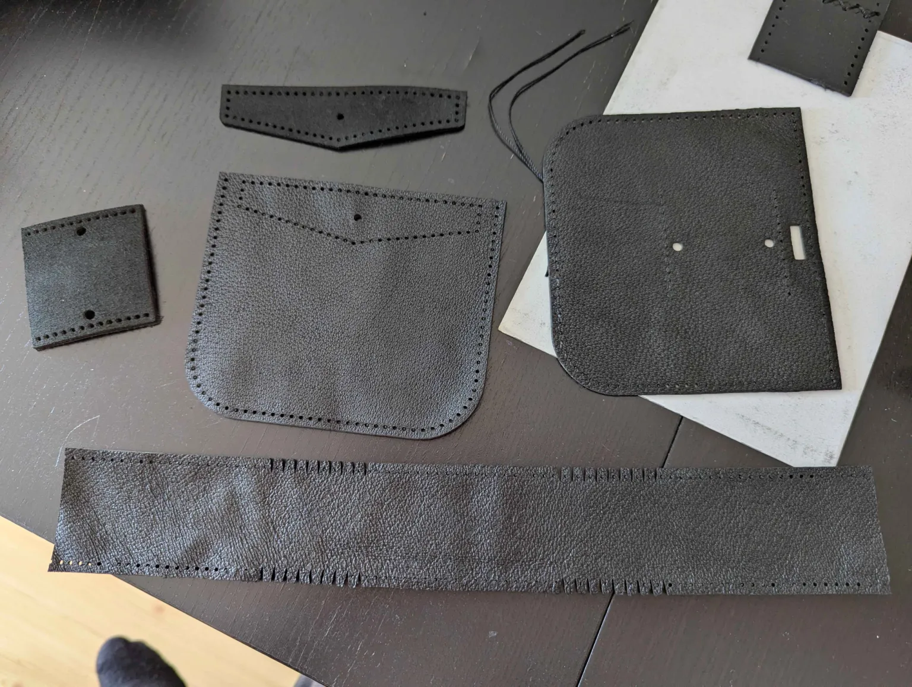
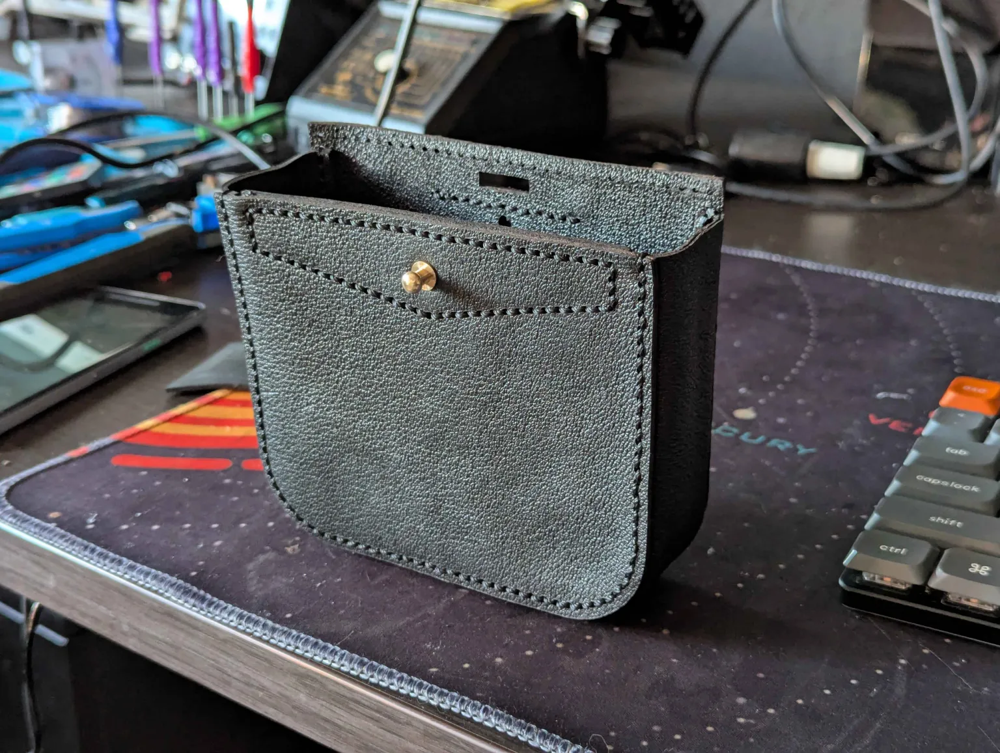
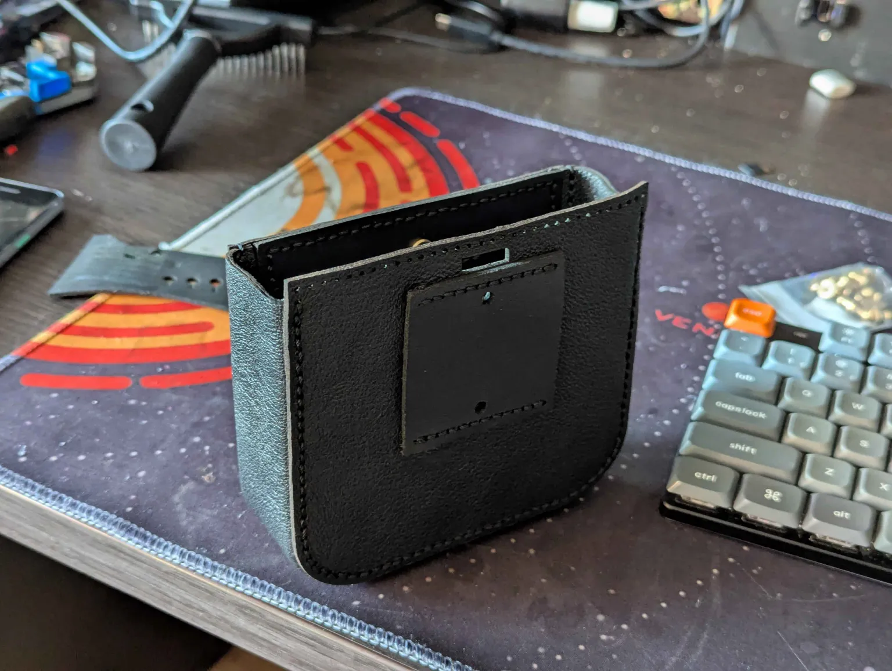
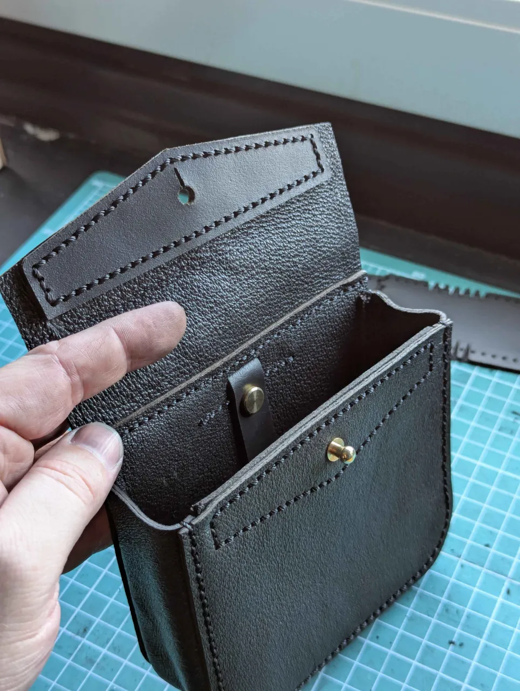

# smaczex

Parametric generator for a laser-cut pouch for dog snacks.

## Contents

- `smaczex.c` — C (Cairo) generator producing SVG parts (front/back/flap/side/strap and stiffener variants, plus test patterns)
- `makefile` — builds and runs the generator, then processes SVG outputs
- `process.sh` — SVG-to-G-code post-processing pipeline using `la` tools
- `LICENSE`

## Photos

